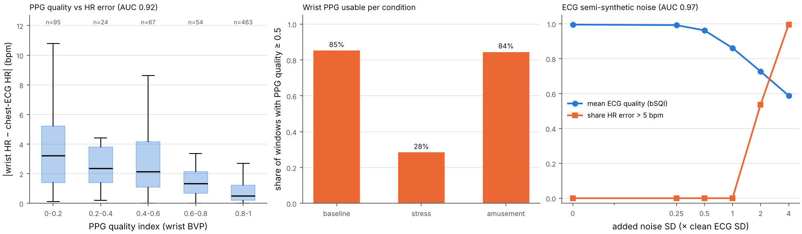
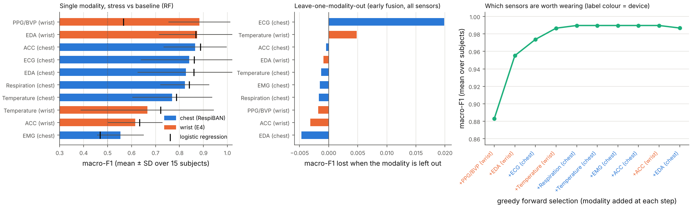
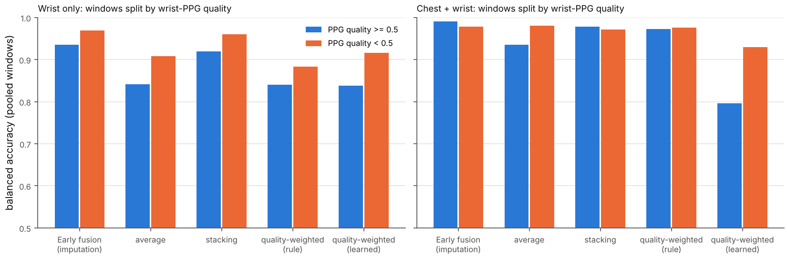
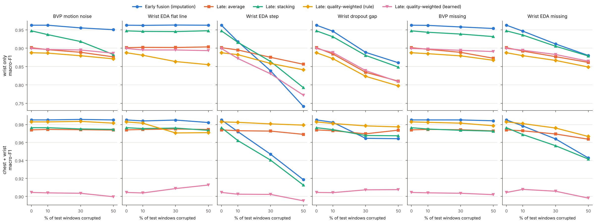

# wesad-quality-aware-fusion

**Signal-quality-aware multimodal fusion for stress detection on the public WESAD dataset.**

How much does each wearable sensor contribute to detecting acute stress, and can a fusion model
*down-weight* a sensor when its signal quality drops or it goes missing, instead of failing with
it? This repository answers both questions on WESAD (15 participants, chest strap + wrist device)
with leave-one-subject-out (LOSO) evaluation, per-modality signal-quality indices, four late-fusion
strategies against early fusion, and natural plus simulated sensor degradation.

**Short answer from the run below.**
With all sensors, every fusion strategy reaches macro-F1 ≈ 0.97–0.98 on stress vs baseline and no single
sensor is indispensable. Quality-weighted late fusion did **not** beat early fusion on clean data or on
the naturally degraded wrist PPG. In WESAD, PPG artefacts occur *because* participants talk and gesture
during the stress test, so the artefacts themselves predict stress, and down-weighting them removes a cue
that early fusion exploits. Late fusion (with or without quality weights) was clearly more robust than
early fusion with imputation in one simulated scenario, wrist-EDA step artefacts (15 of 15
participants, Holm-adjusted p = 0.003). That benefit came from averaging over sensors, not from the
quality index, which detected few of those steps.

## Motivation

The companion repository
[`ahr-stress-trigger`](https://github.com/lizxu-byte/ahr-stress-trigger-public) found that wrist PPG from the
Empatica E4 is usable in only ~23 % of TSST (stress) windows: the sensor fails exactly when it matters.
In its deep-baseline comparison, a random forest reached macro-F1 0.95 with wrist EDA and 0.86 without
it. A real stress monitor therefore needs to know (a) which sensors carry the information, and (b) how to
keep working when one of them degrades. A common proposal is to weight each sensor by a per-window
signal-quality index. This repository tests that proposal honestly, including the case where it does not
help.

## Quick start

```bash
pip install -e ".[test]"            # Python >= 3.11; installs ahr-stress-trigger pinned to commit 02357a9
pytest                              # 28 tests on synthetic data only, no download needed
python scripts/download_wesad.py    # official WESAD download (~2.2 GB) + local cache in data/ (git-ignored)
python scripts/run_all.py           # full analysis -> results/  (~14 min on 4 CPU cores)
python scripts/run_all.py --quick   # 4 subjects, LR only: smoke test (< 1 min)
```

`data/` is git-ignored. **No WESAD file and no per-window derived data is committed**: `results/` holds
aggregated tables, per-subject summary rows and figures only.

## Repository layout

| Path | Content |
|---|---|
| `src/fusion/io.py` | WESAD loader for **both** devices (all chest + wrist channels), compact cache; builds on `ahr.io_wesad` |
| `src/fusion/features.py` | window-local features and quality index for 10 modalities |
| `src/fusion/quality.py` | quality-index building blocks: beat agreement (bSQI), Kleckner EDA rules, breathing-peak dominance, flat-line / clipping / range rules |
| `src/fusion/dataset.py` | windows, per-subject calibration (both from `ahr.windows`), feature tables, test-time corruption of a window |
| `src/fusion/artefacts.py` | simulated artefacts (BVP motion noise, EDA flat line / step, wrist dropout gap) |
| `src/fusion/robustness.py` | which test windows are corrupted, recomputed features, test variants |
| `src/fusion/models.py` | base classifiers, early fusion, late fusion (average, stacking, quality-weighted rule / learned) |
| `src/fusion/evaluate.py` | LOSO runner (parallel over folds), metrics, Wilcoxon helper |
| `src/fusion/synthetic.py` | synthetic chest + wrist recordings for the tests |
| `scripts/` | `download_wesad.py`, `run_all.py` |
| `tests/` | windowing, calibration, LOSO / stacking leakage, quality indices vs injected artefacts, test variants |
| `results/` | tables and figures of the WESAD run (see *Results*) |

### Code reused from `ahr-stress-trigger` (installed, pinned to `02357a98322db2f50561524d3d445b3883bde12f`)

`ahr.io_wesad` (pickle reader, label constants, subject list), `ahr.windows` (60 s windows, ≥ 95 %
label purity, calibration interval, LOSO splits, macro-F1, balanced accuracy), `ahr.ppg` (band-pass,
Elgendi peak detector, IBI cleaning, windowed HR / RMSSD / SDNN), `ahr.sqi` (PPG template correlation
and spectral entropy), `ahr.ecg` (R-peak detector) and `ahr.motion` (per-axis gravity removal, activity
magnitude). Nothing is vendored; the package is a pinned dependency.

## Data, as verified

WESAD (Schmidt et al., 2018), downloaded from the official University of Siegen sciebo link (checked
reachable; no mirrors). Units and rates below were checked against `wesad_readme.pdf` inside the archive
**and** against the value ranges in every subject's synchronised `SX.pkl`:

| Device | Signal | Rate | Unit in `SX.pkl` |
|---|---|---|---|
| chest (RespiBAN) | ECG, EMG | 700 Hz | mV (already converted; ADC range ±1.5 mV) |
| chest | EDA | 700 Hz | µS |
| chest | Resp | 700 Hz | % (piezo belt) |
| chest | Temp | 700 Hz | °C |
| chest | ACC (3 axes) | 700 Hz | g |
| wrist (Empatica E4) | BVP | 64 Hz | arbitrary PPG units |
| wrist | EDA | 4 Hz | µS |
| wrist | TEMP | 4 Hz | °C |
| wrist | ACC (3 axes) | 32 Hz | 1/64 g (converted to g here); clips at −128 / +127 counts (±2 g) |

Labels are at 700 Hz on the chest clock (1 baseline, 2 stress/TSST, 3 amusement). Both devices start
at the same instant in the pickles, and all channels have identical durations for all 15 subjects
(checked). The per-subject readmes note that the chest temperature sensor was *not fully attached*
for S2 and S17; all subjects are kept.

**Windows.** 60 s windows with a 30 s step; a window is used only if ≥ 95 % of it lies inside one
condition. **Per-subject calibration** is the same as in `ahr-stress-trigger`: the first 5 min of each
subject's baseline. Windows overlapping that interval are excluded from training and evaluation; the
8 windows lying fully inside it give each subject's calibration mean, which is subtracted from every
feature (quality indices are not calibrated). For each modality only calibration windows with quality ≥ 0.5
enter the mean (all of them if fewer than two qualify). A test checks that changing data after the
calibration interval leaves the calibration means unchanged. This yields 874 evaluated windows:
26–28 baseline, 19–23 stress and 10–11 amusement per subject (`results/windows_per_subject.csv`),
identical to the counts in `ahr-stress-trigger`.

**Tasks.** Main: stress vs baseline (binary). Secondary: baseline vs stress vs amusement.

## Features (per modality, per window)

All processing is **window-local**: the raw samples of a window plus a short padding for filter
settling. A corrupted test window therefore changes nothing outside itself, and clean and corrupted
windows run through identical code. If > 50 % of a window's samples are missing, that modality's
features are NaN and its quality is 0.

| Modality | Processing | Features |
|---|---|---|
| ECG (chest) | R peaks (`ahr.ecg`, Pan–Tompkins style), IBI cleaning (`ahr.ppg.clean_ibi`) | HR, RMSSD, SDNN |
| BVP (wrist) | sign-inverted (E4 polarity), band-pass 0.5–8 Hz, Elgendi et al. (2013) peaks, IBI cleaning (all `ahr`) | HR, RMSSD, SDNN |
| EDA (chest; wrist separately) | chest resampled to 8 Hz; low-pass 1 Hz; tonic = 0.05 Hz low-pass; phasic = rest; SCR = phasic peak with prominence ≥ 0.01 µS, ≥ 1 s apart | tonic level, tonic slope (µS/min), SCR rate (/min), mean SCR amplitude |
| Respiration (chest) | resampled to 10 Hz, band-pass 0.1–0.7 Hz | rate (peak of the spectrum), amplitude (2√2 · SD) |
| EMG (chest) | high-pass 20 Hz (4th order) | mean and SD of 1 s RMS |
| Temperature (chest; wrist) | 1 s means | mean, slope (°C/min) |
| ACC (chest; wrist) | chest resampled to 32 Hz; per-axis gravity removal (`ahr.motion`) | mean and SD of dynamic-acceleration magnitude |

## Quality indices (per modality, per window, in [0, 1])

| Modality | Index | Source |
|---|---|---|
| PPG | share of the seven 30 s sub-windows (5 s step) passing the `ahr-stress-trigger` rule: beat-template correlation ≥ 0.8 (Orphanidou et al., 2015), spectral entropy ≤ 0.75, valid IBIs cover ≥ 50 % | reused unchanged from `ahr.sqi` / `ahr.ppg` |
| ECG | agreement of two independent R-peak detectors, `n_matched / (n_A + n_B − n_matched)`, 150 ms tolerance, × (1 − share of samples at the ±1.5 mV ADC limit). A = `ahr.ecg` (Pan & Tompkins-style); B = Elgendi (2013) QRS detector (band-pass 8–20 Hz, W1 = 97 ms, W2 = 611 ms, offset β = 0.08, block ≥ W1) | bSQI idea of Li, Mark & Clifford (2008); see *Not verified* |
| EDA | 1 − share of invalid samples by the rules of Kleckner et al. (2018): EDA outside 0.05–60 µS, change faster than ±10 µS/s, and everything within 5 s of an invalid sample. **Added here**: flat line (identical raw samples for ≥ 10 s). Kleckner's skin-temperature rule (30–40 °C) is implemented but **off**: wrist temperature is 29–31 °C throughout for S15 and S16 (S16's readme notes a cold room), so it would discard their entire wrist EDA | Kleckner et al. (2018), thresholds checked in the paper |
| Respiration | power within ±0.05 Hz of the largest peak in 0.1–0.7 Hz divided by power in 0.05–1 Hz, × (1 − flat-line share) | ad hoc, no published threshold |
| Temperature | 1 − share of samples outside 20–42 °C, changing > 0.5 °C/s, or flat ≥ 120 s | generic rule |
| ACC | 1 − share of samples clipped (wrist ±2 g; chest ±6 g) or flat on all axes ≥ 30 s | generic rule |
| EMG | 1 − share of samples at the ADC limit or flat ≥ 1 s | generic rule |

Every index is multiplied by (1 − share of missing samples).

### Quality-index validation (WESAD, `results/quality_*.csv`, `results/figures/quality_validation.png`)



* **PPG vs an independent reference.** Windows with a clean chest-ECG reference (ECG quality ≥ 0.9;
  all 874) are labelled *bad* if wrist HR is missing or differs from ECG HR by > 5 bpm. The PPG quality
  index ranks good above bad windows with **AUC 0.92** (Spearman ρ between quality and HR error −0.54).
  HR error by quality bin:

  | PPG quality | windows | wrist HR available | MAE vs ECG (bpm) | HR missing or error > 5 bpm |
  |---|---|---|---|---|
  | 0–0.2 | 248 | 38 % | 4.8 | 72 % |
  | 0.2–0.4 | 30 | 80 % | 3.2 | 27 % |
  | 0.4–0.6 | 78 | 86 % | 3.1 | 31 % |
  | 0.6–0.8 | 55 | 98 % | 2.0 | 13 % |
  | 0.8–1 | 463 | 100 % | 1.0 | 2 % |

  Share of windows with PPG quality ≥ 0.5: **85 % baseline, 28 % stress, 85 % amusement**, matching the
  ~23 % reported by `ahr-stress-trigger` for 30 s windows. After injecting motion noise into the BVP
  (see below) the AUC is 0.85.
* **ECG.** The chest ECG never degrades in WESAD: its quality is ≥ 0.96 in every window. Against the
  wrist HR on windows with excellent PPG quality, only 9 of 463 windows disagree by > 5 bpm, and the ECG
  index does not rank them (AUC 0.49): those disagreements are more likely PPG errors. The ECG index was
  therefore validated **semi-synthetically**: EMG-like (20–150 Hz), in-band electrode-motion (5–25 Hz)
  and baseline-wander (0.5–2 Hz) noise in equal parts was added to 300 real ECG windows at six levels,
  and HR from the noisy signal was compared with HR from the clean one. The index ranks windows with HR
  error > 5 bpm with **AUC 0.97** (mean quality 0.996 → 0.59 as the error share rises from 0 to 100 %;
  `quality_validation_ecg_noise.csv`). This shows the index responds to noise that breaks HR, not that it
  catches real-world ECG failures.
* **Response to the injected artefacts** (`quality_artefact_response.csv`, 2382 corrupted windows per
  scenario): BVP motion noise lowers PPG quality below 0.5 in 95 % of corrupted windows (35 % when clean);
  an EDA flat line lowers EDA quality below 0.5 in 91 %; a wrist dropout gap zeroes or halves all wrist
  indices. **EDA step artefacts are mostly not detected** (mean EDA quality 1.00 → 0.84, none below 0.5):
  Kleckner's ±10 µS/s rule catches a step at 4 Hz only if it exceeds 2.5 µS.

## Models and fusion

All models use identical LOSO folds (15 folds), are fitted on the 14 training subjects only and use
fixed hyper-parameters; nothing is tuned on the held-out subject.

* **Base classifiers** (per modality and for early fusion): logistic regression (C = 1, balanced class
  weights, standardised) and random forest (500 trees, min. 2 samples per leaf, balanced), as in
  `ahr-stress-trigger`. Missing feature values are imputed with **training-set medians**.
* **Device subsets**: wrist only (BVP, wrist EDA, wrist TEMP, wrist ACC), chest only (ECG, chest EDA,
  respiration, EMG, chest TEMP, chest ACC), both.
* **Early fusion**: one classifier on the concatenated features of the subset.
* **Late fusion** of the per-modality class probabilities:
  1. *average*: mean over the modalities present in the window;
  2. *stacking* (Wolpert, 1992): logistic regression on the per-modality log-probabilities. These come
     from inner 5-fold grouped cross-validation over the training subjects (no subject in both inner
     train and inner validation); a missing modality contributes the training class prior;
  3. *quality-weighted, rule*: weighted mean with `w_m = q_m` if `q_m ≥ 0.5`, else 0 (falls back to the
     average if all weights are 0);
  4. *quality-weighted, learned*: weighted mean with `w_m = exp(a_m + b_m · q_m)`, `b_m ≥ 0` (weight can
     only grow with quality). `a, b` minimise the class-balanced log-loss of the inner out-of-fold
     probabilities, with an L2 penalty of 0.01.

  Tests check that the test subject never enters training, inner folds, stacking or the learned
  weights.

## Robustness experiments

* **Natural degradation**: clean LOSO predictions split by wrist-PPG quality (< 0.5 vs ≥ 0.5).
* **Simulated degradation, test time only.** In each test subject, 10 / 30 / 50 % of the windows of each
  class are drawn at random (3 seeds, averaged per subject). Their raw signals are corrupted, and features
  and quality are **recomputed from the corrupted signal**:
  * *BVP motion noise*: Gaussian noise band-limited to 0.5–3 Hz, SD 1–3 × the clean BVP SD, over 50–100 %
    of the window;
  * *wrist EDA flat line*: value frozen for 30–80 % of the window;
  * *wrist EDA step*: +1 to +5 µS from a random time in the first 70 % of the window;
  * *wrist dropout gap*: all wrist channels missing for 30–70 % of the window;
  * *BVP missing* / *wrist EDA missing*: modality absent (features NaN, quality 0).

  Additionally each modality is dropped from **all** test windows (`results/missing_modality.csv`).
* **Statistics**: macro-F1 and balanced accuracy per held-out subject, mean ± SD over the 15 subjects;
  two-sided Wilcoxon signed-rank tests across subjects with the number of subjects where each strategy
  wins. Holm correction is applied within each family (comparison type × task × classifier;
  `results/wilcoxon.csv` gives raw and Holm p).

## Results (WESAD, 15 participants)

All numbers come from `python scripts/run_all.py` (`results/summary.json` and the CSVs named below).
Random forest base models unless stated; logistic-regression results are in the same files.

### 1. Clean data

Macro-F1, mean ± SD over subjects (balanced accuracy differs from macro-F1 by at most 0.05 for every fusion model; both are in
`summary_clean.csv`):

| Strategy | wrist, binary | chest, binary | both, binary | wrist, 3-class | both, 3-class |
|---|---|---|---|---|---|
| Early fusion (imputation) | **0.96 ± 0.11** | 0.96 ± 0.14 | **0.98 ± 0.03** | **0.80 ± 0.15** | **0.84 ± 0.15** |
| Late: average | 0.90 ± 0.10 | 0.96 ± 0.04 | 0.97 ± 0.04 | 0.71 ± 0.14 | 0.72 ± 0.10 |
| Late: stacking | 0.95 ± 0.12 | **0.97 ± 0.03** | 0.98 ± 0.04 | 0.75 ± 0.13 | 0.79 ± 0.09 |
| Late: quality-weighted (rule) | 0.89 ± 0.11 | 0.96 ± 0.04 | 0.98 ± 0.03 | 0.69 ± 0.15 | 0.72 ± 0.11 |
| Late: quality-weighted (learned) | 0.90 ± 0.14 | 0.90 ± 0.13 | 0.90 ± 0.10 | 0.69 ± 0.16 | 0.65 ± 0.14 |

On the wrist, rule-based quality weighting is worse than early fusion in 12 of 15 subjects
(mean −0.075, p = 0.002, Holm p = 0.035). With both devices the two are equivalent (3 better, 3 worse,
9 ties; p = 0.92). Chest-only early fusion fails for one subject (S2: 0.47), which stacking rescues (0.91).
Early fusion with RF on the wrist (0.96) is close to the `ahr-stress-trigger` wrist result (0.95), with
different features.

### 2. Which sensors are worth wearing



Single-modality models (binary, macro-F1, RF / LR): wrist BVP 0.88 / 0.57, wrist EDA 0.87 / 0.87,
chest ACC 0.87 / 0.89, ECG 0.84 / 0.86, chest EDA 0.83 / 0.86, respiration 0.82 / 0.84,
chest temperature 0.77 / 0.79, wrist temperature 0.67 / 0.72, wrist ACC 0.62 / 0.63, EMG 0.55 / 0.47.

* **Leave-one-modality-out** (early fusion, all sensors, `leave_one_modality_out.csv`): no single
  modality matters. The largest loss is 0.02 (ECG), none is significant (RF: all p ≥ 0.18; LR: largest
  loss 0.009, all p ≥ 0.11), and several
  removals slightly *improve* the score. The sensors are highly redundant for this lab contrast.
* **Forward selection** (`forward_selection.csv`, RF): wrist BVP (0.88) → + wrist EDA (0.96) → + ECG
  (0.97) → + wrist temperature (0.99); no further gain. With LR the order is chest ACC (0.89) → + wrist
  EDA (0.94) → + EMG (0.96) → + respiration (0.98).
* **Wearability.** A wrist device alone reaches 0.89–0.96 depending on the fusion strategy. Adding the
  chest strap raises this to 0.98 and, more usefully, makes late fusion robust to wrist failures (see 4).
  A chest strap is rarely worn in daily life, though, and part of what it contributes in WESAD is posture:
  participants stand during the TSST, which chest ACC picks up and which would not transfer outside the
  lab. Wrist EDA is the one wrist sensor whose loss hurts every wrist-only model
  (`missing_modality.csv`: wrist-only macro-F1 drops from 0.96 to 0.76 for early fusion and to
  0.79–0.81 for late fusion).
* The ranking is **descriptive**: forward selection uses the same LOSO scores it reports, so its
  curve is optimistic.

### 3. Natural degradation: windows where the wrist PPG is bad



219 of 306 stress windows but only 60 of 407 baseline windows have PPG quality < 0.5
(`natural_degradation.csv`, pooled over subjects). In those low-quality windows, wrist-only balanced
accuracy is **0.97 for early fusion, 0.96 stacking, 0.91 average, 0.92 learned and 0.88 rule-based
quality weighting**. With both devices, every strategy except the learned weights is at 0.97–0.98.
**Quality weighting does not help on naturally degraded windows.** The reason is visible in the
single-PPG model: its stress recall is 0.93 in low-quality windows and 0.69 in high-quality ones. Its
features (implausible HRV from artefacts) *become a stress marker* when the signal breaks. Consistent with this, the
quality indices alone classify stress vs baseline with macro-F1 0.76 (RF) / 0.84 (LR), and PPG quality
alone with 0.77 (`quality_only_confound.csv`). Down-weighting low-quality PPG discards a cue that is
predictive in this protocol, where artefacts come from speaking and gesturing during the TSST. Outside
the lab, artefacts come from many non-stress activities, and the cue would not transfer.

### 4. Simulated degradation (test time only)



(3-class: `results/figures/corruption_curves_three_class.png`; all numbers in `corruption_curves.csv`.)

Binary macro-F1 at 50 % corrupted test windows (clean → 50 %), RF:

| Scenario | set | early | average | stacking | QW rule | QW learned |
|---|---|---|---|---|---|---|
| BVP motion noise | wrist | 0.96 → **0.95** | 0.90 → 0.88 | 0.95 → 0.88 | 0.89 → 0.87 | 0.90 → 0.89 |
| wrist EDA flat line | wrist | 0.96 → **0.96** | 0.90 → 0.90 | 0.95 → 0.95 | 0.89 → 0.86 | 0.90 → 0.89 |
| wrist EDA step | wrist | 0.96 → 0.74 | 0.90 → **0.86** | 0.95 → 0.79 | 0.89 → 0.84 | 0.90 → 0.77 |
| wrist dropout gap | wrist | 0.96 → **0.86** | 0.90 → 0.81 | 0.95 → 0.85 | 0.89 → 0.80 | 0.90 → 0.81 |
| wrist EDA missing | wrist | 0.96 → **0.88** | 0.90 → 0.86 | 0.95 → 0.88 | 0.89 → 0.85 | 0.90 → 0.86 |
| wrist EDA step | both | 0.98 → 0.92 | 0.97 → 0.97 | 0.98 → 0.91 | 0.98 → **0.98** | 0.90 → 0.90 |
| wrist EDA missing | both | 0.98 → 0.94 | 0.97 → 0.96 | 0.98 → 0.94 | 0.98 → **0.97** | 0.90 → 0.90 |

Does quality-weighted late fusion degrade more gracefully than early fusion with imputation?

* **Wrist EDA step: yes, but because of late fusion, not because of quality.** Early fusion loses 0.22
  on the wrist and the rule-based quality weighting loses 0.05. The smaller loss holds in **15 of 15
  subjects** (Holm p = 0.003; same for LR). The plain average does as well as the quality-weighted
  version (wrist: 0.86 vs 0.84; 4 better / 8 worse, p = 0.12), because the quality index flags almost no
  steps. A plausible-looking but shifted EDA value drives a single early-fusion model far off, while
  averaging dilutes it among the other sensors. With both devices, the quality-weighted model keeps 0.98
  vs 0.92 for early fusion at 50 % (13 / 1 subjects, uncorrected p = 0.005, Holm p = 0.19).
* **Wrist EDA missing (with both devices): late fusion tends to degrade less** (loss 0.01 for the
  average and 0.02 for rule-based quality weighting vs 0.04 for early fusion; average vs early 5 / 1
  subjects with 9 ties, uncorrected p = 0.046; quality-weighted vs early 6 / 4, p = 0.14; neither
  significant after Holm). Median imputation fills the missing EDA with a value that carries no
  information about the current window, while late fusion simply drops it.
* **BVP noise / BVP missing / wrist gap / EDA flat line: no advantage.** Early fusion stays at least as
  good, and its loss from clean to 50 % does not differ significantly from that of rule-based quality
  weighting (all Holm p = 1.0). Stacking degrades *more* than early fusion under BVP motion noise on the
  wrist (14 / 1 subjects, Holm p = 0.045). For the EDA
  flat line, quality weighting is even *worse* than the plain average (wrist 0.86 vs 0.90; 2 / 11
  subjects, uncorrected p = 0.016). A frozen EDA sensor still reports a plausible skin-conductance level,
  so discarding it loses information. Losing the PPG costs ≤ 0.05 for every strategy, because its contribution is
  largely redundant with EDA and temperature.
* The learned quality weights do not adapt usefully (`qw_learned_weights_lr.csv`). On training data,
  low-quality PPG predicts stress, so the fitted quality slope for BVP is ≈ 0 (`b` = 0.00 with all
  sensors, 0.10 wrist-only). The weights concentrate on the modalities that were best on average (wrist
  EDA 65 % of the weight on the wrist), which generalises worse across subjects than equal weights. (For
  modalities whose quality is always ≈ 1, only `a + b` is identified, hence `a ≈ b` in that table.)

### 5. Three-class task (baseline / stress / amusement)

Much harder for every model: early fusion reaches 0.84 ± 0.15 with both devices and 0.80 ± 0.15 on the
wrist. Here late fusion is clearly worse than early fusion (rule-based quality weighting on the wrist:
1 / 14 subjects, Holm p = 0.03). Most per-modality models cannot separate amusement from baseline
on their own, so averaging their probabilities blurs the amusement class. Simulated-degradation patterns
match the binary task (EDA steps at 50 %, wrist: early 0.80 → 0.59, average 0.71 → 0.65, rule-based
quality weighting 0.70 → 0.65).

## Interpretation

1. **Sensor contribution.** In this lab contrast, information is spread over many sensors. Wrist EDA
   is the most valuable single wearable signal, and a wrist device alone already separates TSST from
   baseline in most participants. The chest strap adds little on clean data but provides redundancy.
2. **Quality weighting did not deliver what it promises on WESAD.** On real data the dominant
   "degradation" (PPG during the TSST) is *confounded with the label*: artefacts mark stress. Any
   model allowed to see artefact-laden features learns that, and a quality weight that removes them makes
   the lab score worse. This is not a failure of the quality index, which ranks PPG HR errors well (AUC 0.92).
   It means WESAD cannot test the benefit of quality weighting on naturally occurring artefacts.
3. **Where late fusion helps, quality is not the reason.** Late fusion was more robust than early fusion
   with median imputation when one wrist modality became *plausibly wrong* (EDA steps) or, with both
   devices, *missing*. The unweighted average was as good as the quality-weighted version because the
   implemented indices miss the most damaging artefact (EDA steps < 2.5 µS). Better artefact detection
   for EDA would be needed before quality weighting could add value.
4. **Recommendation for a daily-life system:** prefer late fusion or stacking over a single early-fusion
   model when sensors may drop out or drift. Treat the quality index as a gate for *which* modalities
   to trust, validated on data where artefacts are not caused by the target state. That requires free-living
   recordings with annotated artefacts and stress episodes, which WESAD does not provide.

## Limitations

* **15 laboratory participants, one TSST each.** Per-subject scores move in steps of a few windows; the
  Wilcoxon tests have little power and many comparisons are made (Holm within families; the raw p
  values in the CSV are uncorrected).
* **Label confounds.** Stress windows differ from baseline in posture (standing), speech and movement, and
  therefore in artefacts. Chest ACC, respiration quality and PPG quality all carry this protocol signal.
* **Simulated artefacts are not real-world artefacts.** The noise models are simple, applied to single
  windows independently, and only to wrist signals; real artefacts are temporally correlated and affect
  several sensors at once.
* **ECG quality is validated only semi-synthetically**; WESAD contains no real ECG failures.
* **The chest strap is rarely worn in daily life**; the "both devices" results describe a research setup.
* **Window-level features ignore context** (no temporal smoothing across windows), and per-subject
  calibration assumes a labelled 5 min rest at the start of use.
* **Fixed hyper-parameters**, chosen in advance and not tuned (tuning on 15 subjects would overfit); the
  forward-selection ranking is optimistic because it selects on the reported LOSO score.

## Not verified / open points

* **bSQI formula.** The idea and citation of Li, Mark & Clifford (2008) are verified (journal page), but
  the original PDF could not be retrieved. The formula `n_matched / (n_A + n_B − n_matched)` with a 150 ms
  tolerance is taken from secondary descriptions of bSQI. The window length (60 s) and the two detectors
  differ from the original paper.
* **Elgendi (2013) QRS detector**: band (8–20 Hz), W1 = 97 ms and W2 = 611 ms are from the paper's text
  and Table 2. The offset is 8 % in Table 2 but written as "0.8" in the text; 0.08 is used. The paper
  attributes the third-order Butterworth filter to earlier work; the filter order used here (3, zero-phase)
  is an assumption.
* **Kleckner et al. (2018)** developed their rules on an Affectiva Q Sensor (16/32 Hz) in children with
  autism. Applying them to a 4 Hz Empatica E4 and a chest RespiBAN in adults is an extrapolation.
* The respiration, temperature, ACC and EMG quality rules are ad hoc and not validated against an
  independent reference.

## Parameter choices to review

| Parameter | Value | Why / evidence |
|---|---|---|
| window / step / purity | 60 s / 30 s / ≥ 95 % | same as `ahr-stress-trigger`; HRV needs ~1 min |
| calibration | first 5 min of baseline, excluded from evaluation; quality ≥ 0.5 windows | same as `ahr-stress-trigger` |
| PPG quality | 0.8 template corr., 0.75 spectral entropy, share of 7 sub-windows | `ahr-stress-trigger` thresholds |
| ECG quality | two detectors, 150 ms tolerance | bSQI convention (secondary sources) |
| EDA quality | Kleckner rules 1, 2, 4; rule 3 off; flat line ≥ 10 s | rule 3 off: S15/S16 wrist temp 29–31 °C; longest clean flat run 4 s |
| SCR detection | prominence ≥ 0.01 µS, ≥ 1 s apart; tonic 0.05 Hz | common minimum amplitude; not tuned |
| ACC flat line | ≥ 30 s | E4 ACC is bit-identical for up to ~10 s when the arm rests |
| temperature rules | 20–42 °C, ≤ 0.5 °C/s, flat ≥ 120 s | generous plausibility limits |
| respiration quality | ±0.05 Hz around the 0.1–0.7 Hz peak | ad hoc; lower during speech (0.45 vs 0.68 at baseline) |
| missing data | > 50 % missing → modality absent | – |
| rule-based quality weight | `w = q` if `q ≥ 0.5` else 0 | simple, not tuned |
| learned quality weight | `exp(a + b q)`, `b ∈ [0, 10]`, `a ∈ [−5, 5]`, L2 0.01 | monotone in quality; not tuned |
| stacking | inner 5-fold grouped CV, LR (C = 1, balanced) on log-probabilities | – |
| classifiers | LR C = 1; RF 500 trees, min leaf 2; balanced weights | as in `ahr-stress-trigger` |
| artefacts | BVP noise 1–3 × SD, 0.5–3 Hz, 50–100 % of window; EDA flat 30–80 %; EDA step +1–5 µS; gap 30–70 % | plausible but arbitrary |
| corruption levels | 10 / 30 / 50 % of each class, 3 seeds | – |
| validation thresholds | HR error > 5 bpm = bad; ECG reference quality ≥ 0.9; PPG reference quality ≥ 6/7 | – |

## References

* Schmidt, P., Reiss, A., Duerichen, R., Marberger, C., & Van Laerhoven, K. (2018). Introducing WESAD, a
  multimodal dataset for wearable stress and affect detection. *Proceedings of the 20th ACM International
  Conference on Multimodal Interaction (ICMI)*, 400–408. https://doi.org/10.1145/3242969.3242985
* Kleckner, I. R., Jones, R. M., Wilder-Smith, O., Wormwood, J. B., Akcakaya, M., Quigley, K. S., Lord, C.,
  & Goodwin, M. S. (2018). Simple, transparent, and flexible automated quality assessment procedures for
  ambulatory electrodermal activity data. *IEEE Transactions on Biomedical Engineering*, 65(7), 1460–1467.
  https://doi.org/10.1109/TBME.2017.2758643
* Li, Q., Mark, R. G., & Clifford, G. D. (2008). Robust heart rate estimation from multiple asynchronous
  noisy sources using signal quality indices and a Kalman filter. *Physiological Measurement*, 29(1),
  15–32. https://doi.org/10.1088/0967-3334/29/1/002
* Elgendi, M. (2013). Fast QRS detection with an optimized knowledge-based method: Evaluation on 11
  standard ECG databases. *PLoS ONE*, 8(9), e73557. https://doi.org/10.1371/journal.pone.0073557
* Elgendi, M., Norton, I., Brearley, M., Abbott, D., & Schuurmans, D. (2013). Systolic peak detection in
  acceleration photoplethysmograms measured from emergency responders in tropical conditions. *PLoS ONE*,
  8(10), e76585.
* Orphanidou, C., Bonnici, T., Charlton, P., Clifton, D., Vallance, D., & Tarassenko, L. (2015).
  Signal-quality indices for the electrocardiogram and photoplethysmogram: derivation and applications to
  wireless monitoring. *IEEE Journal of Biomedical and Health Informatics*, 19(3), 832–838.
* Pan, J., & Tompkins, W. J. (1985). A real-time QRS detection algorithm. *IEEE Transactions on Biomedical
  Engineering*, BME-32(3), 230–236. https://doi.org/10.1109/TBME.1985.325532
* Wolpert, D. H. (1992). Stacked generalization. *Neural Networks*, 5(2), 241–259.
  https://doi.org/10.1016/S0893-6080(05)80023-1

## Data licence

WESAD is provided by the University of Siegen for **non-commercial, academic use only** and may not be
redistributed. This repository contains no WESAD data; `scripts/download_wesad.py` fetches it from the
official source. Please cite Schmidt et al. (2018) when using the dataset.

The code is released under the MIT licence (`LICENSE`).
